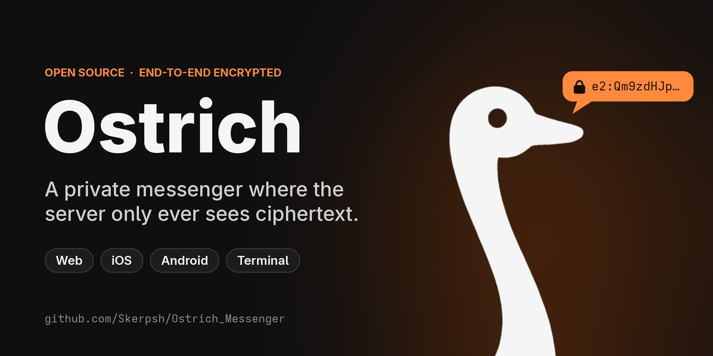
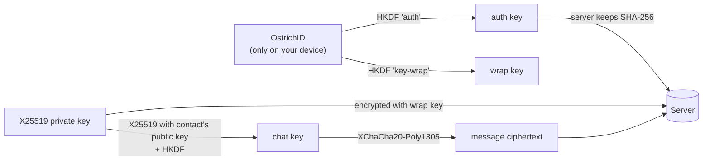
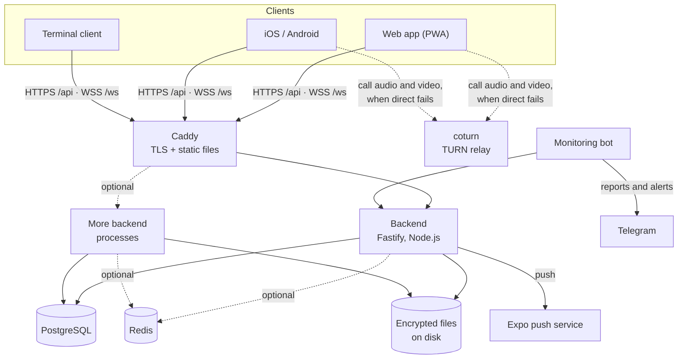

<div align="center">



[](https://github.com/Skerpsh/Ostrich_Messenger/actions/workflows/ci.yml)
[](https://github.com/Skerpsh/Ostrich_Messenger/releases/latest)
[](LICENSE)


[**Download**](#download) ·
[**Open the web app**](https://ostrich-messenger.online) ·
[Install the CLI](#terminal-client-cli) ·
[Self-host](#self-hosting-on-a-server) ·
[How the encryption works](#how-the-encryption-works)

</div>

---

## Contents

- [Features](#features)
- [Download](#download)
- [Quick start for users](#quick-start-for-users)
- [Terminal client (CLI)](#terminal-client-cli)
- [How the encryption works](#how-the-encryption-works)
- [Architecture](#architecture)
- [Local development](#local-development)
- [Self-hosting on a server](#self-hosting-on-a-server)
- [Configuration](#configuration)
- [Operations: deploys, backups and monitoring](#operations-deploys-backups-and-monitoring)
- [Testing and CI](#testing-and-ci)
- [Releasing](#releasing)
- [Project structure](#project-structure)
- [Contributing](#contributing)
- [Contact](#contact)
- [Security](#security)
- [Code signing policy](#code-signing-policy)
- [License](#license)

## Features

**Privacy**
- 🔐 **End-to-end encryption** of messages, files, calls, group names and group photos (X25519 + XChaCha20-Poly1305 + HKDF-SHA256)
- 🪪 **OstrichID**: a 20-character recovery key, created on your device and never sent to the server
- 🛡 **Safety codes**: compare 40 digits with a contact to make sure nobody swapped your keys
- ⚠️ **Key change warnings**: sending is paused until you confirm a contact's new key
- 👁 Optional online status and read receipts, blocking, per-device sessions with remote log out
- 📲 **Log in with a QR code**: a logged-in device scans it and sends the account's key encrypted for the new device only

**Messaging**
- 💬 Direct chats, **groups** of up to 50 members with roles, **invite links** and join requests
- 📎 Encrypted **files and photos** (up to 10 per message, 25 MB each) with upload progress and a photo viewer
- 🎤 Encrypted **voice messages** with a waveform, seeking and playback speed
- 📞 **Audio and video calls**, peer to peer and end-to-end encrypted, with the **Ostrich handshake** to make sure nobody is listening in
- 🔗 **Link previews** made by the sender's phone and sent inside the encrypted message, so the server never sees the link
- ↩️ Replies, forwarding, editing, deleting, **reactions with any emoji**, pinned messages
- 🔖 **Saved messages**, @mentions, formatting, search in a chat or across all chats
- ⌨️ Typing indicators, read receipts, unread counters, jump to the first unread message
- 📌 Pin, mute, clear and delete chats

**Personalization**
- 🎨 Light, dark and **pure black** themes, nine accent colors or **your own**, with contrast checked in both themes
- 🐦 **Chat wallpapers**: ostrich patterns in the accent color or your own photo, three brightness levels
- 🖼 A **look for each chat**: its own accent and wallpaper, for you or for everyone in it (sent end-to-end encrypted)
- 🔠 Text size, a compact or minimal chats list, and an **app icon** that follows the accent
- 🔄 Optional **sync across devices**, encrypted with your account's key

**Everywhere**
- 🌐 Installable **web app** (PWA) that works offline
- 📱 **iOS and Android** apps from the same code, with push notifications
- 🖥 Full-featured **terminal client** with mouse support, QR codes and offline cache
- 🌗 Light and dark themes with an accent color
- ⌨️ Keyboard shortcuts in the web app (Ctrl/⌘ K, Alt ↑/↓, ↑ to edit, Esc)

## Download

| System | Get Ostrich |
|---|---|
| 🤖 **Android** | [**Download the APK**](https://github.com/Skerpsh/Ostrich_Messenger/releases/latest/download/Ostrich-Android.apk) — open it on the phone and allow installing when asked |
| 🪟 **Windows** | [**Download the installer**](https://github.com/Skerpsh/Ostrich_Messenger/releases/latest/download/Ostrich-Windows-Setup.exe) · Terminal: [ostrich-windows-amd64.exe](https://github.com/Skerpsh/Ostrich_Messenger/releases/latest/download/ostrich-windows-amd64.exe) |
| 🐧 **Linux** | [**AppImage**](https://github.com/Skerpsh/Ostrich_Messenger/releases/latest/download/Ostrich-Linux.AppImage) (any distribution, updates itself) · [.deb](https://github.com/Skerpsh/Ostrich_Messenger/releases/latest/download/Ostrich-Linux.deb) (Ubuntu, Debian) · [.rpm](https://github.com/Skerpsh/Ostrich_Messenger/releases/latest/download/Ostrich-Linux.rpm) (Fedora, openSUSE) · [Flatpak](https://github.com/Skerpsh/Ostrich_Messenger/releases/latest/download/Ostrich-Linux.flatpak) · Terminal: [x86-64](https://github.com/Skerpsh/Ostrich_Messenger/releases/latest/download/ostrich-linux-amd64), [ARM64](https://github.com/Skerpsh/Ostrich_Messenger/releases/latest/download/ostrich-linux-arm64) or the [one-line install](#terminal-client-cli) |
| 🍎 **macOS** | Terminal: [Apple silicon](https://github.com/Skerpsh/Ostrich_Messenger/releases/latest/download/ostrich-darwin-arm64), [Intel](https://github.com/Skerpsh/Ostrich_Messenger/releases/latest/download/ostrich-darwin-amd64) |
| 📱 **iOS** | Coming to the App Store |
| 🌐 **Web** | [ostrich-messenger.online](https://ostrich-messenger.online): nothing to install, and installable as an app from the browser |

Every file of every version: [releases](https://github.com/Skerpsh/Ostrich_Messenger/releases).

All clients use the same account, the same chats and the same encryption.

## Quick start for users

1. Open the [web app](https://ostrich-messenger.online) or install the [CLI](#terminal-client-cli).
2. **Create an account** with a `@username` and a password.
3. **Save your OstrichID.** It is shown **once**. Keep it in a password manager or on paper.
   You need it to log in on a new device. Nobody, including the server owner, can recover it for you.
4. Start a chat: **New chat** → type the exact `@username` of your contact.
5. Optional: open the chat's **safety code** and compare the 40 digits with your contact
   in person or over another channel. If they match, your conversation cannot be read by the server.

**Logging in on another device.** Either enter your username, password and OstrichID, or
choose **Log in with a QR code** (`Ctrl+L` in the CLI) and scan the code with a device where you
are already logged in: **Settings → Devices → Link a device**. Only scan codes shown on your own
devices.

> [!IMPORTANT]
> Lose your OstrichID and you lose access to your messages on new devices. This is the
> price of the server knowing nothing about them.

To install the web app, use the browser's **Install app** / **Add to Home Screen** option.
It keeps working offline and sends messages when it is back online.

**Calls.** Press 📞 or 🎥 at the top of a direct chat. Calls ring while Ostrich is open (a
browser tab, or the app in the foreground); the chat gets an entry for every call, missed ones
too. A video call shows your camera before you answer, with or without it; the camera can be
turned on and off in any call, and the videos shown one in a corner or side by side. During a
call, open the **Ostrich handshake**: each of you reads a silly sentence aloud ("Sleepy flamingo
juggles cacti") and picks the other's among four. If both find it, nobody is in the middle of the
call.

In the web app, **Settings → Keyboard shortcuts** lists the keys: `Ctrl/⌘ K` search chats,
`Alt ↑/↓` previous / next chat, `↑` edit your last message, `Esc` cancel or close the chat.

## Terminal client (CLI)

<table><tr><td>

**Linux and macOS**

```bash
curl -fsSL https://github.com/Skerpsh/Ostrich_Messenger/releases/latest/download/install.sh | sh
```

The script downloads the build for your system, checks its SHA-256 checksum and puts it in
`~/.local/bin/ostrich`.

**Windows**

Download `ostrich-windows-amd64.exe` from the
[latest release](https://github.com/Skerpsh/Ostrich_Messenger/releases/latest).
SmartScreen asks once: *More info* → *Run anyway*.

**From source** (Go 1.27+)

```bash
cd apps/cli && go build -o ostrich . && ./ostrich
```

</td></tr></table>

Then run `ostrich`. Chats are on the left and the open chat is on the right, or one at a time
in a narrow terminal. The keyboard and the mouse both work.

### Most useful keys

| Where | Keys |
|---|---|
| Login screen | `Tab` log in / create account · `Ctrl+L` log in with a QR code · `Ctrl+R` remember me |
| Chats list | `↑↓` move · `Enter` open · `/` search · `n` new chat · `m` chat menu · `s` settings · `t` theme · `q` quit |
| Chat | `Enter` send · `Alt+Enter` new line · `Ctrl+A` attach a file · `↑` choose a message · `Ctrl+F` search · `Ctrl+K` safety code · `Esc` back |
| Chosen message | `r` reply · `e` edit · `d` delete · `c` copy · `1`–`8` react · `Enter` more |

Voice messages are shown with their waveform and length; play them in the web or mobile app.
Calls are answered in the web or mobile app; the CLI says who is calling and shows the chat's
call entries.
Link previews are shown as text.

The full key reference, the "Remember me" option, where sessions and the cache are stored and
other details are in [`apps/cli/README.md`](apps/cli/README.md).

| Environment variable | Purpose |
|---|---|
| `OSTRICH_SERVER` | Use another backend, e.g. `http://localhost:3000` |
| `OSTRICH_WEB` | The web app's address for invite and profile links (default: Ostrich's site, or `OSTRICH_SERVER` when set) |
| `OSTRICH_NO_UPDATE_CHECK=1` | Do not check for a newer release at start |

## How the encryption works

The full specification is at the top of [`apps/mobile-web/src/crypto/crypto.ts`](apps/mobile-web/src/crypto/crypto.ts).
The Go client implements the same scheme in [`apps/cli/crypto.go`](apps/cli/crypto.go), and both are
tested against shared vectors in [`shared/test-vectors/crypto-vectors.json`](shared/test-vectors/crypto-vectors.json).



- **Account.** Each account has a random X25519 key pair. The server stores the public key and the
  private key **encrypted with a key derived from your OstrichID**, so any device that knows the
  OstrichID can unlock it. The server never sees the OstrichID itself.
- **Direct chats.** Both sides derive the same chat key from X25519 and HKDF. Every message is
  encrypted with XChaCha20-Poly1305. The chat, sender and message ids are bound in as associated
  data, so the server cannot move, replay or reattribute messages.
- **Files and voice messages.** Each file has its own random key, which travels inside the
  encrypted message. A voice message is an audio file, plus its length and waveform.
- **Link previews.** The sender's phone loads the page (so that site sees the sender's IP
  address) and puts its title, description and a small picture inside the encrypted message. The
  server never sees the link. The web app only shows previews: browsers cannot load other sites.
  A preview is shown only for a link that is in the message's text.
- **Groups.** A random group key is wrapped separately for every member. A new key epoch starts
  whenever someone leaves or is removed. The group name and photo are encrypted too.
- **Calls.** The audio and video go straight between the two devices (WebRTC), or through the TURN
  server when they cannot reach each other, encrypted with DTLS-SRTP either way. The offer and
  answer that set the call up carry the fingerprints of the call's certificates, and they are
  themselves encrypted for the other member, so the server cannot swap them to listen in. The
  **Ostrich handshake** checks even that: both devices turn the two fingerprints into two sentences,
  each person reads theirs aloud and picks the other's among four. The caller commits to its part of
  the input before seeing the callee's, so someone in the middle gets a single 1-in-a-million try.
  Details in [`apps/mobile-web/src/features/calls/handshake.ts`](apps/mobile-web/src/features/calls/handshake.ts).
- **Safety codes.** 40 digits computed from both public keys. If the codes match on both devices,
  the server has not substituted a key.
- **Logging in with a QR code.** The new device shows a one-time X25519 public key in its QR
  code. The device that scans it sends the account's private key encrypted for that key, so the
  server only relays ciphertext. The session goes to the device that holds the link's secret,
  which is not in the code, so seeing the code is not enough to log in.
- **Settings sync.** If you turn it on, your personalization is stored on the server encrypted
  with a key derived from your account's private key, so only your devices can read it. A chat's
  wallpaper set "for everyone" is an ordinary encrypted message.

**What the server can see:** usernames, who talks to whom and when (calls included), message
sizes, profile photos, and IP addresses. **What it cannot see:** message text, files, what is
said and shown in calls, group names and photos, synced settings and chat wallpapers, your
OstrichID or your private key.

> [!NOTE]
> Ostrich has not had an independent security audit. Read
> [SECURITY.md](SECURITY.md) before relying on it for anything critical.

## Architecture



| Part | Stack | Directory |
|---|---|---|
| Backend | Node.js 22, TypeScript, Fastify 5, PostgreSQL (`pg`), WebSockets, Argon2, optional Redis | [`apps/server/`](apps/server) |
| Web and mobile apps | Expo SDK 57, React Native 0.86, expo-router, `@noble/*` cryptography | [`apps/mobile-web/`](apps/mobile-web) |
| Terminal client | Go, Bubble Tea | [`apps/cli/`](apps/cli) |
| Server operations | Bash, systemd, Caddy | [`deploy/`](deploy) |

## Local development

### Requirements

- **Node.js 22** and npm
- **PostgreSQL 13+**
- **Go 1.27+** (only for the CLI)
- Redis (optional, only to test several backend processes)

### 1. Database

```bash
sudo -u postgres psql -c "CREATE USER ostrich WITH PASSWORD 'ostrich';"
sudo -u postgres psql -c "CREATE DATABASE ostrich_db OWNER ostrich;"
```

### 2. Backend

```bash
cd apps/server
npm install
cat > .env <<'EOF'
DB_HOST=localhost
DB_NAME=ostrich_db
DB_USER=ostrich
DB_PASSWORD=ostrich
EOF
npm run db:migrate   # creates the tables
npm run dev          # http://localhost:3000, restarts on changes
```

Check it: `curl http://localhost:3000/api/health` should answer `{"status":"ok","database":"connected",...}`.

### 3. Web and mobile app

```bash
cd apps/mobile-web
npm install
echo 'EXPO_PUBLIC_API_URL=http://localhost:3000' > .env.local
npm start            # then press w for web, i for iOS, a for Android
```

When testing on a phone, use your computer's LAN IP instead of `localhost`
(e.g. `http://192.168.1.10:3000`).

### 4. Terminal client

```bash
cd apps/cli
go build -o ostrich .
OSTRICH_SERVER=http://localhost:3000 ./ostrich
```

### Mobile apps

The apps are built with [EAS Build](https://docs.expo.dev/build/introduction/)
(profiles are in [`apps/mobile-web/eas.json`](apps/mobile-web/eas.json)):

```bash
cd apps/mobile-web
npx eas-cli build --platform android --profile preview   # installable APK
npx eas-cli build --platform ios --profile production
npx eas-cli build --platform android --profile quest     # APK for Meta Quest
```

On a Meta Quest (in developer mode) the APK is installed with `adb install -r ostrich.apk`
and runs as a window, without the phone or the computer; it opens from Library → Unknown
sources. The headset has no Google Play services, so notifications only come while the app is
open.

For your own server, set `EXPO_PUBLIC_API_URL` to its address for the build, and
`EXPO_PUBLIC_WEB_URL` too if the web app is on another address (it is used for invite and
profile links). The apps ask for the camera (QR codes and video calls) and the microphone (voice
messages and calls). Calls need a development or store build: `react-native-webrtc` does not run in Expo Go.

### Useful commands

| Where | Command | What it does |
|---|---|---|
| `apps/server/` | `npm run dev` | Development server with reload |
| `apps/server/` | `npm test` | Tests |
| `apps/server/` | `npm run typecheck` | Type check, including tests |
| `apps/server/` | `npm run db:migrate` | Apply new migrations |
| `apps/server/` | `npm run dev-badge -- add @username` | Give a user the DEV badge |
| `apps/mobile-web/` | `npm start` | Expo development server |
| `apps/mobile-web/` | `npm test` · `npm run lint` · `npm run typecheck` | Checks |
| `apps/mobile-web/` | `npm run build:web` | Static web build in `dist/` |
| `apps/cli/` | `go test ./...` · `go vet ./...` | Checks |

## Self-hosting on a server

This walks through one Ubuntu/Debian VPS running everything: the backend, PostgreSQL and Caddy,
which provides HTTPS and serves the web app. The [`deploy/`](deploy) scripts assume this layout:

| What | Where |
|---|---|
| Repository | `/opt/ostrich` |
| Backend settings | `/opt/ostrich/apps/server/.env` |
| Backend service | systemd unit `ostrich` |
| Web app files | `/var/www/ostrich-web` |
| Backups | `/var/backups/ostrich` |

### 1. Install the software

```bash
apt-get update && apt-get install -y git curl rsync postgresql caddy
curl -fsSL https://deb.nodesource.com/setup_22.x | bash - && apt-get install -y nodejs
```

([Caddy's install guide](https://caddyserver.com/docs/install) covers adding its repository if
your distribution does not ship it. Node from [nvm](https://github.com/nvm-sh/nvm) works too: the
systemd units find it.)

### 2. Get the code and create the database

```bash
git clone https://github.com/Skerpsh/Ostrich_Messenger.git /opt/ostrich
sudo -u postgres psql -c "CREATE USER ostrich WITH PASSWORD 'CHANGE_ME';"
sudo -u postgres psql -c "CREATE DATABASE ostrich_db OWNER ostrich;"
```

### 3. Configure the backend

```bash
cat > /opt/ostrich/apps/server/.env <<'EOF'
DB_HOST=localhost
DB_NAME=ostrich_db
DB_USER=ostrich
DB_PASSWORD=CHANGE_ME
HOST=127.0.0.1
CORS_ORIGINS=https://chat.example.com
EOF
chmod 600 /opt/ostrich/apps/server/.env
```

### 4. Create the systemd service

```bash
cat > /etc/systemd/system/ostrich.service <<'EOF'
[Unit]
Description=Ostrich backend
After=network.target postgresql.service

[Service]
WorkingDirectory=/opt/ostrich/apps/server
EnvironmentFile=/opt/ostrich/apps/server/.env
Environment=NODE_ENV=production
ExecStart=/bin/bash -c '[ -s /root/.nvm/nvm.sh ] && . /root/.nvm/nvm.sh; exec node dist/server.js'
Restart=always
RestartSec=2
TimeoutStopSec=15

[Install]
WantedBy=multi-user.target
EOF
systemctl daemon-reload && systemctl enable ostrich
```

### 5. Configure Caddy

Point your domain's DNS at the server, then replace `/etc/caddy/Caddyfile`:

```caddy
chat.example.com {
	handle /api/* {
		reverse_proxy 127.0.0.1:3000
	}
	handle /ws {
		reverse_proxy 127.0.0.1:3000
	}
	handle {
		root * /var/www/ostrich-web
		try_files {path} /index.html
		file_server
	}

	header {
		Content-Security-Policy "frame-ancestors 'none'"
		X-Frame-Options "DENY"
		X-Content-Type-Options "nosniff"
		Referrer-Policy "no-referrer"
		Strict-Transport-Security "max-age=31536000"
	}
}
```

Caddy gets and renews the HTTPS certificate on its own.

### 6. Point the clients at your server and deploy

Build the web app for your domain and run the deploy script. It builds the backend, applies the
migrations, restarts the service, checks that it answers, then builds and publishes the web app:

```bash
echo 'EXPO_PUBLIC_API_URL=https://chat.example.com' > /opt/ostrich/apps/mobile-web/.env.local
cd /opt/ostrich && deploy/deploy.sh --no-backup && systemctl reload caddy
```

Open `https://chat.example.com`. For the CLI, run it with
`OSTRICH_SERVER=https://chat.example.com ostrich`. The web app and the API share one address
here, so links need no extra setting. If you serve the web app from another domain, see
`EXPO_PUBLIC_WEB_URL` and `OSTRICH_WEB` in [Configuration](#configuration), and add that origin to
`CORS_ORIGINS`.

Next steps: [daily backups](#backups), [monitoring](#monitoring) and a
[TURN server for calls](deploy/README.md#calls-the-turn-server).

## Configuration

The backend reads its settings from environment variables, usually in `apps/server/.env`.

| Variable | Default | Description |
|---|---|---|
| `DB_HOST` | `localhost` | PostgreSQL host |
| `DB_PORT` | `5432` | PostgreSQL port |
| `DB_NAME` | `ostrich_db` | Database name |
| `DB_USER` | `ostrich` | Database user |
| `DB_PASSWORD` | none | Database password |
| `PORT` | `3000` | HTTP port |
| `HOST` | `0.0.0.0` | Address to listen on. Use `127.0.0.1` behind a reverse proxy. |
| `CORS_ORIGINS` | any | Comma-separated browser origins allowed to call the API |
| `TRUST_PROXY` | `loopback` | Proxies trusted for `X-Forwarded-For`: `true`, `false` or an address list |
| `REDIS_URL` | none | Shared state for several backend processes, e.g. `redis://127.0.0.1:6379` |
| `ATTACHMENTS_DIR` | `apps/server/data/attachments` | Where encrypted files are stored |
| `EXPO_ACCESS_TOKEN` | none | Expo token for push notifications, if your Expo project requires one |
| `MONITOR_SECRET` | none | Shared secret for the monitoring bot's stats endpoint |
| `TURN_URLS` | none | TURN servers for calls, comma separated, e.g. `turn:203.0.113.7:3478?transport=udp,turn:203.0.113.7:3478?transport=tcp` |
| `STUN_URLS` | none | STUN servers for calls, e.g. `stun:203.0.113.7:3478` |
| `TURN_SECRET` | none | coturn's `static-auth-secret`: the backend makes TURN logins with it ([setup](deploy/README.md#calls-the-turn-server)) |

The monitoring bot's own settings (`MONITOR_*`) are listed in
[`deploy/README.md`](deploy/README.md#monitoring-bot).

Client settings:

| Client | Variable | Default |
|---|---|---|
| Web / mobile | `EXPO_PUBLIC_API_URL` (in `apps/mobile-web/.env.local`, at build time): the API | `https://62.238.111.55.nip.io` |
| Mobile | `EXPO_PUBLIC_WEB_URL` (at build time): the web app, for links | `https://ostrich-messenger.online`, or the API's address when `EXPO_PUBLIC_API_URL` is set |
| CLI | `OSTRICH_SERVER`: the API | `https://62.238.111.55.nip.io` |
| CLI | `OSTRICH_WEB`: the web app, for links | `https://ostrich-messenger.online`, or `OSTRICH_SERVER` when that is set |

The official setup serves the API at `62.238.111.55.nip.io` and the web app at
`ostrich-messenger.online`. The web app always makes links to the address it was opened from.

## Operations: deploys, backups and monitoring

The complete guide is [`deploy/README.md`](deploy/README.md). In short:

### Deploys

```bash
cd /opt/ostrich && deploy/deploy.sh                 # backend + web, with a backup first
deploy/deploy.sh --backend-only                     # or --web-only, --no-backup
```

### Database migrations

Schema changes live in [`apps/server/migrations/`](apps/server/migrations) as numbered SQL files. Each
file is applied once, in its own transaction, and recorded in `schema_migrations`. To change the
schema, add the next numbered file. Never edit an applied one.

### Backups

[`deploy/backup.sh`](deploy/backup.sh) writes a compressed `pg_dump` and keeps the 7 newest copies. It
skips the backup when the disk is nearly full and can ping
[Healthchecks.io](https://healthchecks.io). Daily runs come from a systemd timer:

```bash
cp /opt/ostrich/deploy/ostrich-backup.{service,timer} /etc/systemd/system/ && systemctl daemon-reload && systemctl enable --now ostrich-backup.timer
```

Restore: `pg_restore --clean --if-exists -d ostrich_db <file>`.

### Monitoring

- **Monitoring bot** ([`apps/server/src/monitor/`](apps/server/src/monitor)): reports to Telegram every
  15 minutes and sends a daily summary. It alerts when the backend is down or slow, the database
  fails, a service crashes, a disk or memory runs low, a backup is missing, errors or failed logins
  spike, or an SSL certificate is about to expire. Commands: `/stats`, `/today`, `/health`.
- **UptimeRobot** watches `/api/health` from outside, so you hear about it even when the whole
  server is down.

### Scaling

One backend process handles a lot. To use several CPU cores or restart without downtime, run
several processes (`deploy/ostrich@.service`) behind Caddy and set `REDIS_URL`. They then share
WebSocket events, presence, rate limits and failed login counts through Redis.

## Testing and CI

```bash
(cd apps/server && npm test && npm run typecheck)
(cd apps/mobile-web && npm test && npm run lint && npm run typecheck)
(cd apps/cli && go vet ./... && go test ./...)
```

[GitHub Actions](.github/workflows/ci.yml) runs all of these on every push and pull request,
plus a `gofmt` check. The TypeScript and Go cryptography is checked against the same test vectors,
so the clients cannot drift apart.

## Releasing

```bash
git tag v1.3.0 && git push origin v1.3.0   # the next version after the latest release
```

The [Release](.github/workflows/release.yml) workflow publishes every app under that version:
the CLI for Linux, macOS and Windows on x86-64 and ARM64 (tested first), the Android app,
an APK built with EAS (the app's version is the tag's; the build number counts up by itself),
and the desktop app for Linux (AppImage, .deb, .rpm, Flatpak) and Windows (an installer).
The release gets the files, `install.sh` and `SHA256SUMS`, a table of what to download for
which system, and notes generated from the commits. The [Download](#download) links always
point at the latest release.

The Android build needs an Expo access token once: create one at
[expo.dev → Account settings → Access tokens](https://expo.dev/settings/access-tokens), then add
it on GitHub under the repository's **Settings → Secrets and variables → Actions → New repository
secret** as `EXPO_TOKEN`. Without it the release has the CLI only.

## Project structure

One repository for every system Ostrich runs on. Each app is in `apps/`, with its own README;
what they share (the protocol, the encryption) is checked against the same test vectors.

```
.
├── apps/
│   ├── mobile-web/         Expo app: Android, iOS and the web (PWA)
│   │   └── src/
│   │       ├── app/        screens (expo-router routes)
│   │       ├── features/   auth, chats, chat, groups, calls, settings, devices
│   │       ├── crypto/     end-to-end encryption (no UI)
│   │       ├── api/        the server: requests, the live connection, links
│   │       ├── ui/         buttons, headers, animations, theme
│   │       └── platform/   what differs between the phones and the web
│   │                       (*.web.ts / *.native.ts next to each other)
│   ├── desktop/            Windows and Linux app (Electron around the web build)
│   ├── server/             Fastify API, WebSockets, PostgreSQL
│   │   ├── migrations/     numbered SQL migrations
│   │   ├── src/routes/     HTTP and WebSocket endpoints
│   │   └── src/monitor/    Telegram monitoring bot
│   └── cli/                Go terminal client
├── shared/test-vectors/    test vectors for the TypeScript and Go code
├── deploy/                 deploy and backup scripts, systemd units, coturn
├── docs/                   which app runs where and how each is built
└── .github/workflows/      CI and CLI releases
```

## Contributing

Bug reports, ideas and pull requests are welcome. See [CONTRIBUTING.md](CONTRIBUTING.md) for how
to set up the project and what a good pull request looks like.

### Beta testers

Thanks to the people who try Ostrich before everyone else and tell us what breaks:

| | Who | What they found |
|---|---|---|
| 🐛 | [@slawti](https://github.com/slawti) | The first Android build on a Pixel: the keyboard covering the message field, notifications that did not pop up, no microphone or camera, panels that would not open |

Want to join? Write to [hello@ostrich-messenger.com](mailto:hello@ostrich-messenger.com).

## Contact

- Help with the app: [support@ostrich-messenger.com](mailto:support@ostrich-messenger.com)
- Vulnerabilities: [security@ostrich-messenger.com](mailto:security@ostrich-messenger.com)
- Personal data requests: [privacy@ostrich-messenger.com](mailto:privacy@ostrich-messenger.com)
- Everything else: [hello@ostrich-messenger.com](mailto:hello@ostrich-messenger.com)

## Security

Please **do not** open public issues for vulnerabilities. Report them privately as described in
[SECURITY.md](SECURITY.md) or by email to
[security@ostrich-messenger.com](mailto:security@ostrich-messenger.com).

## Code signing policy

Free code signing on Windows provided by [SignPath.io](https://signpath.io), certificate by
[SignPath Foundation](https://signpath.org).

- Committers and reviewers: [@Skerpsh](https://github.com/Skerpsh)
- Approvers: [@Skerpsh](https://github.com/Skerpsh)

Only builds made by the [Release](.github/workflows/release.yml) workflow on GitHub, from the
code in this repository at a version tag, are signed, and each signing is approved by hand. Team
members use two-factor authentication on GitHub.

**Privacy.** Ostrich does not transfer any information to other networked systems unless the
person using it asks for it, except what a messenger needs to work:

- the Ostrich server the app is set up with (by default Ostrich's own): the account, contacts and
  messages, which are end-to-end encrypted, so the server cannot read them
- calls: directly between the two devices, or through the server's own relay (TURN), encrypted
- push notifications on Android and iOS: through Expo and Google's or Apple's push service; they
  only say "New message", never its text or sender
- link previews: made by the sender's device, which loads the linked page
- the desktop app checks GitHub releases for updates

Questions: [privacy@ostrich-messenger.com](mailto:privacy@ostrich-messenger.com).

## License

[MIT](LICENSE) © 2026 Skerpsh
